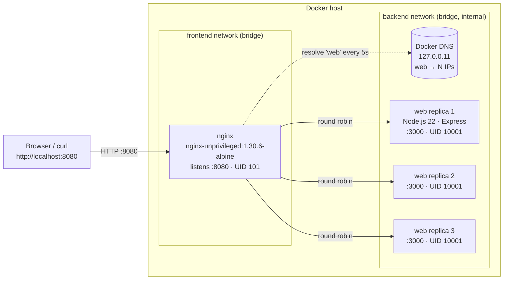

# Container-Orchestration: ContainerOps Dashboard

> Week 04 Hands-On Assignment: **Containerization & Orchestration**

**ContainerOps Dashboard** is a lightweight Node.js/Express monitoring dashboard. It is packaged as a hardened, multi-stage OCI image and orchestrated with Docker Compose as **three load-balanced replicas behind an Nginx reverse proxy**. The project covers:

- OCI containerization with a secure, non-root, multi-stage `Dockerfile`
- Docker Compose orchestration of two services (`web`, `nginx`)
- Nginx load balancing with Docker DNS service discovery and DNS re-resolution
- Horizontal scaling (`docker compose up -d --scale web=N`)
- Health monitoring (`HEALTHCHECK`, `/healthz`, `/readyz`)
- Container failure recovery through Docker restart policies
- An audit of deliberately flawed, AI-generated configurations (`audit/`)
- An automated QA script (`tests/qa-test.sh`)

---

## Table of Contents

1. [Overview](#1-project-overview)
2. [Features](#2-application-features)
3. [Technology Stack](#3-technology-stack)
4. [Architecture Overview](#4-architecture-overview)
5. [Architecture Diagram](#5-architecture-diagram)
6. [Dockerfile Design Decisions](#6-dockerfile-design-decisions)
7. [Multi-Stage Build](#7-multi-stage-build)
8. [Docker Layer Caching](#8-docker-layer-caching)
9. [Non-Root Execution](#9-non-root-execution)
10. [Docker Compose Orchestration Strategy](#10-docker-compose-orchestration-strategy)
11. [Nginx Load Balancing](#11-nginx-load-balancing)
12. [Resource Limits and Health Checks](#12-resource-limits-and-health-checks)
13. [Prerequisites](#13-prerequisites)
14. [Installation](#14-installation)
15. [Build](#15-build)
16. [Deployment](#16-deployment)
17. [Browser Access](#17-browser-access)
18. [API Endpoints](#18-api-endpoint-documentation)
19. [Horizontal Scaling](#19-horizontal-scaling)
20. [Self-Healing Verification](#20-self-healing-verification)
21. [Image Inspection](#21-image-inspection)
22. [Security Audit Summary](#22-security-audit-summary)
23. [QA Testing](#23-qa-testing)
24. [QA Results Template](#24-qa-results-template)
25. [Troubleshooting](#25-troubleshooting)
26. [Containerization Trade-offs](#26-containerization-trade-offs)
27. [AI Assistance Disclosure](#27-ai-assistance-disclosure)
28. [AI Prompt Log](#28-ai-prompt-log)
29. [Publishing to GitHub](#29-publishing-to-github)

---

## 1. Project Overview

Each request to `http://localhost:8080` reaches **Nginx**, which forwards it to one of several identical **Node.js containers**. The dashboard shows which container answered: its hostname, container ID, Node.js version, uptime and request counter. Refreshing the page, or using the built-in **Load Balancing Sampler**, shows traffic moving between replicas.

## 2. Application Features

- Dark, responsive dashboard that works on desktop and mobile
- Overall health indicator (Operational / Degraded / Unavailable)
- Live runtime data from the backend (nothing is hardcoded):
  - container hostname and container ID (derived from the Docker hostname)
  - Node.js version, platform and process UID
  - server uptime, start time and current server timestamp
  - per-instance request counter (health probes are counted separately)
  - liveness (`/healthz`) and readiness (`/readyz`) status
- **Refresh Server Data** button with loading states
- **Load Balancing Sampler**, which sends N requests and charts which replica served each one
- Graceful error handling: request timeouts, error banner and degraded status
- Graceful shutdown on `SIGTERM` / `SIGINT`. Readiness switches to 503 and in-flight requests are drained
- Security headers (CSP, `X-Frame-Options`, `nosniff`, ...), `X-Powered-By` disabled, and only `GET`/`HEAD` allowed

## 3. Technology Stack

| Layer | Technology |
|---|---|
| Runtime | Node.js 22 LTS (`node:22.23.4-alpine3.24`) |
| Web framework | Express.js 5.3.0 (the only dependency) |
| Frontend | HTML5, CSS3, vanilla JavaScript |
| Container | Docker (OCI image, BuildKit multi-stage build) |
| Orchestration | Docker Compose v2 (`compose.yaml`) |
| Reverse proxy / LB | Nginx 1.30.6 (`nginxinc/nginx-unprivileged:1.30.6-alpine`) |

The project doesn't use Kubernetes, a database, a frontend framework or any cloud service.

## 4. Architecture Overview

| Component | Role | Network | Host port |
|---|---|---|---|
| `nginx` | Public entry point, reverse proxy, round-robin load balancer | `frontend` + `backend` | `127.0.0.1:8080` → `8080` |
| `web` × 3 | Stateless Express app replicas listening on port 3000 | `backend` only (`internal: true`) | none |

- **Service discovery:** Docker's embedded DNS (`127.0.0.11`) resolves the service name `web` to one IP address **per running replica**.
- **Isolation:** the `backend` network is `internal`, so web replicas have no route to the internet and can't be reached from the host. Only Nginx can reach them.
- **Statelessness:** every replica is identical and keeps only in-memory counters, so any replica can serve any request.

## 5. Architecture Diagram



## 6. Dockerfile Design Decisions

See [`Dockerfile`](Dockerfile).

| Decision | Implementation | Reason |
|---|---|---|
| Explicit, maintained base image | `node:22.23.4-alpine3.24` (via `ARG NODE_IMAGE`) | Node 22 LTS on Alpine. Small and reproducible |
| Multi-stage build | `deps` stage → `runtime` stage | Only runtime files reach the final image |
| Manifests first | `COPY package.json package-lock.json ./` before the source | Dependency layer stays cached |
| Reproducible install | `npm ci --omit=dev --ignore-scripts` | Exact lockfile versions, production deps only, no install scripts |
| No package managers at runtime | npm, npx, corepack and yarn removed | Smaller image and attack surface |
| Dedicated user | `appuser` / `appgroup`, UID/GID `10001`, no shell or home | Least privilege |
| Explicit `USER` | `USER appuser:appgroup` | Process never runs as root |
| Read-only code | Files owned by `root:root`, `644`/`755` | The app can't modify itself |
| Health check without curl/wget | `HEALTHCHECK CMD ["node","app/healthcheck.js"]` | Uses Node's built-in `http` module |
| Exec-form `CMD` | `CMD ["node","app/server.js"]` | Signals reach Node, so graceful shutdown works |
| No secrets | Only `NODE_ENV` and `PORT` are set | Nothing sensitive in image layers |

## 7. Multi-Stage Build

A multi-stage build uses several `FROM` instructions in one Dockerfile. Each stage starts clean, and the final stage copies **only selected artifacts** from earlier stages with `COPY --from=<stage>`.

```text
deps stage:     node:22-alpine + package*.json → npm ci --omit=dev → /build/node_modules
                (npm cache, lockfile tooling, build-only environment)
                       │  COPY --from=deps /build/node_modules
                       ▼
runtime stage:  node:22-alpine − npm/yarn/corepack + node_modules + app/  →  final image
```

**Benefits**

- **Smaller image.** The npm cache, temporary files and package managers never reach the final image. If native modules needed compilers, those would also stay in the build stage.
- **Smaller attack surface.** Fewer binaries and packages mean fewer CVEs and fewer tools for an attacker.
- **Clear separation** between how the image is built and what runs in production.

## 8. Docker Layer Caching

Each Dockerfile instruction produces a layer. Docker reuses a cached layer while the instruction **and everything before it** is unchanged. As soon as one layer changes, every later layer is rebuilt.

```dockerfile
COPY package.json package-lock.json ./   # changes rarely
RUN npm ci --omit=dev ...                # cached unless the manifests change
...
COPY app ./app                           # changes often, but is cheap to rebuild
```

Because the source code is copied **after** dependencies are installed, editing `app/public/styles.css` rebuilds only the cheap final layers, and `npm ci` shows `CACHED`. The flawed [`audit/initial.Dockerfile`](audit/initial.Dockerfile) runs `COPY . .` before `npm install`, so **any** file change triggers a full reinstall. The BuildKit cache mount (`--mount=type=cache,target=/root/.npm`) also keeps npm's download cache between builds without storing it in the image.

To see caching in action:

```bash
docker compose build
echo "/* cache test */" >> app/public/styles.css
docker compose build          # the npm ci step shows CACHED
git checkout app/public/styles.css
```

## 9. Non-Root Execution

By default, containers run as **root (UID 0)**. If the application is compromised, root inside the container can modify any file in the container, use the default Linux capabilities, and has a better chance of escaping through kernel or runtime bugs or mounted volumes.

This project applies non-root execution in several layers:

1. `Dockerfile` creates `appuser` (UID 10001) and declares `USER appuser:appgroup`.
2. `compose.yaml` sets `user: "10001:10001"` as well, so the setting is explicit even if the image changes.
3. `cap_drop: [ALL]` (port 3000 needs no capabilities) and `no-new-privileges:true`.
4. `read_only: true` root filesystem with a small `noexec,nosuid` tmpfs at `/tmp`.
5. Nginx uses the **unprivileged** image (UID 101, port 8080), so it needs no capabilities either.

## 10. Docker Compose Orchestration Strategy

[`compose.yaml`](compose.yaml) defines two services:

- **`web`**
  - built from the local `Dockerfile` and tagged `containerops-dashboard:1.0.0`
  - `deploy.replicas: ${WEB_REPLICAS:-3}`, so `docker compose up -d` starts 3 replicas
  - **no `container_name` and no host `ports:`**: both must be unique per container and would block scaling. `expose: 3000` documents the internal port only
  - environment-driven configuration (`APP_NAME`, `APP_ENV`, `SHUTDOWN_TIMEOUT_MS`)
  - health check, `restart: unless-stopped`, `init: true`, `stop_grace_period: 15s`
  - CPU, memory and PID limits and reservations, rotated logs, plus the hardening from §9
- **`nginx`**
  - pinned `nginxinc/nginx-unprivileged:1.30.6-alpine`, config mounted read-only
  - published on `${HOST_BIND:-127.0.0.1}:${HOST_PORT:-8080}`
  - `depends_on: web: condition: service_healthy`, so Nginx starts only after a replica is healthy
  - health check against its own `/nginx-health` endpoint (using `wget`, which ships in the nginx image)

Configuration is read from the shell or an optional `.env` file (copy from [`.env.example`](.env.example)). **No secrets are required.**

### What Docker Compose does *not* do

Docker Compose is **not** a cluster orchestrator, and it has **no Kubernetes-style reconciliation loop**:

- **Restart policies** (`restart: unless-stopped`) are applied by the **Docker Engine** to an **existing container** when its process exits unexpectedly (a crash, `OOMKilled`, a non-zero or even a zero exit code). The same container is restarted, and its `RestartCount` increases.
- Docker treats `docker stop` and `docker kill` as **manual stops**, so restart policies **do not** restart them (verified on Docker Engine 29.x with `always`, `unless-stopped` and `on-failure`).
- If a container is **deleted** (`docker rm -f`), **nothing recreates it**. Compose doesn't keep watching the replica count. The count is restored only when you run `docker compose up -d` (or `--scale web=3`) again.
- A container that is running but reports `unhealthy` is **not** restarted automatically by Docker Engine or Compose. The health status is used for `depends_on` ordering and for visibility. (Docker Swarm or Kubernetes would replace it.)

## 11. Nginx Load Balancing

See [`nginx/nginx.conf`](nginx/nginx.conf).

```nginx
resolver 127.0.0.11 valid=5s ipv6=off;           # Docker embedded DNS, re-resolve every 5 s

upstream web_backend {
    zone web_backend 64k;                         # shared memory, required for 'resolve'
    server web:3000 resolve max_fails=1 fail_timeout=10s;
    keepalive 16;
}
```

- **Service discovery:** `web` is the Compose **service name**. No container IPs are hard-coded.
- **DNS re-resolution:** with the `resolve` parameter (available in **open-source** Nginx since 1.27.3), Nginx re-queries Docker DNS while running and updates the upstream list **without a reload**. Replicas added with `--scale`, removed, or restarted with a new IP are picked up within about `valid=5s`.
- **Algorithm:** round-robin across every IP that `web` resolves to.
- **Failover:** `proxy_next_upstream error timeout http_502 http_503 http_504` retries a request on another replica (safe here because every endpoint is an idempotent `GET`). A failing peer is skipped for `fail_timeout`.
- **Forwarded headers:** `Host`, `X-Real-IP`, `X-Forwarded-For`, `X-Forwarded-Proto`, `X-Forwarded-Host`, `X-Forwarded-Port`, `X-Request-ID`. The app trusts exactly one proxy hop (`trust proxy = 1`).
- **Observability:** the access log includes `upstream=<replica-ip>:3000`, so `docker compose logs nginx` shows the distribution.

### Limitations

- **Passive health checks only.** Open-source Nginx has no active upstream health checks (`health_check` is an NGINX Plus feature). Nginx learns that a replica is down only when a real request to it fails, and then retries elsewhere. During the first moment of a failure, **a single request can still fail** (for example a connect timeout on a replica that just died, or a 502 while the peer list is updated). The QA script measures this and doesn't hide it.
- **DNS caching window.** Changes become visible to Nginx only after the `valid=5s` TTL expires. Docker DNS also lists only *running* containers, regardless of health. A replica that is running but not yet ready can receive traffic briefly, and the failover retry covers that case.
- **Older Nginx versions.** Before 1.27.3, open-source Nginx resolved `server web:3000;` **once at startup** and kept stale IPs. The common workaround (`set $u web; proxy_pass http://$u:3000;`) loses `upstream` features such as keepalive and `max_fails`. This project pins 1.30.6 to avoid that problem.
- **Single proxy.** Nginx itself is a single container and a single point of failure. That's acceptable for a local demo, but production would run redundant load balancers.
- **Single host.** Compose runs every replica on one Docker host, so scaling adds concurrency, not hardware redundancy.

## 12. Resource Limits and Health Checks

| Service | CPU limit | Memory limit | PIDs limit | CPU reservation | Memory reservation |
|---|---|---|---|---|---|
| `web` (each replica) | 0.50 | 128 MiB | 100 | 0.10 | 64 MiB |
| `nginx` | 0.50 | 64 MiB | 100 | 0.05 | 16 MiB |

With Docker Compose (non-Swarm), the **limits** are enforced through cgroups. The **reservations** become soft limits (`MemoryReservation`, CPU shares) and are not a scheduling guarantee.

| Probe | Where | Command | Interval / timeout / retries / start period |
|---|---|---|---|
| Image `HEALTHCHECK` | `Dockerfile` | `node app/healthcheck.js` → `GET /healthz` | 15 s / 5 s / 3 / 10 s |
| `web` healthcheck | `compose.yaml` (overrides the image) | `node app/healthcheck.js` | 10 s / 5 s / 3 / 10 s (start interval 2 s) |
| `nginx` healthcheck | `compose.yaml` | `wget -q -O /dev/null http://127.0.0.1:8080/nginx-health` | 10 s / 5 s / 3 / 5 s |

- `/healthz` (**liveness**) returns 200 whenever the process and event loop respond.
- `/readyz` (**readiness**) returns 200 only after the server is listening and before shutdown starts. Otherwise it returns **503**.

## 13. Prerequisites

| Tool | Version | Check |
|---|---|---|
| Docker Engine or Docker Desktop | 24+ (tested with 29.x) with BuildKit | `docker version` |
| Docker Compose plugin | v2.24+ | `docker compose version` |
| curl | any | `curl --version` |
| Git | any | `git --version` |
| For `tests/qa-test.sh`: bash, plus **one of** jq / python3 / node | any | `bash --version` |

Node.js does **not** need to be installed on the host because everything runs in containers. Port **8080** must be free.

## 14. Installation

```bash
git clone https://github.com/<your-github-username>/Container-Orchestration.git
```

```bash
cd Container-Orchestration
```

Optional: create a local `.env` (all values have defaults, and no secrets are needed):

```bash
cp .env.example .env
```

## 15. Build

```bash
docker compose build
```

```bash
docker images
```

```bash
docker images containerops-dashboard
```

The image is tagged `containerops-dashboard:1.0.0`. To build without Compose:

```bash
docker build -t containerops-dashboard:1.0.0 .
```

## 16. Deployment

Start the stack in the background (3 web replicas + Nginx):

```bash
docker compose up -d
```

Optional: block until every container is healthy:

```bash
docker compose up -d --wait
```

Check status. Every container should show `(healthy)`:

```bash
docker compose ps
```

Follow the logs (Ctrl+C to stop following):

```bash
docker compose logs -f
```

```bash
docker compose logs -f nginx
```

Stop and remove the containers and networks:

```bash
docker compose down
```

Also remove the built image:

```bash
docker compose down --rmi local
```

## 17. Browser Access

Open **<http://localhost:8080>**.

- Click **Refresh Server Data**. The hostname and container ID change as different replicas answer.
- Use **Load Balancing Sampler → Sample Replicas**. With three healthy replicas you'll see three hostnames with roughly equal counts.
- By default Nginx is bound to `127.0.0.1` only. To reach it from another device on your network, set `HOST_BIND=0.0.0.0` in `.env` and run `docker compose up -d` again.

## 18. API Endpoint Documentation

All endpoints are `GET` (`HEAD` also works). Other methods return `405`. API responses send `Cache-Control: no-store`.

| Method & path | Success | Description |
|---|---|---|
| `GET /` | 200 `text/html` | Dashboard |
| `GET /healthz` | 200 | Liveness probe |
| `GET /readyz` | 200 / **503** | Readiness probe |
| `GET /api/info` | 200 | Runtime information of the serving instance |
| `GET /api/instances` | 200 | Metadata of the replica that handled this request (for load-balancing demos) |
| anything else | 404 | `{"error":"Not Found"}` |

**`GET /healthz`**

```json
{ "status": "healthy", "hostname": "0574f6b096a7", "timestamp": "2026-11-09T02:43:36.182Z" }
```

**`GET /readyz`**: `200 {"status":"ready",...}` or `503 {"status":"not-ready","reason":"shutting-down",...}`

**`GET /api/info`**

```json
{
  "application": "ContainerOps Dashboard",
  "environment": "production",
  "status": "healthy",
  "hostname": "0574f6b096a7",
  "containerId": "0574f6b096a7",
  "nodeVersion": "v22.23.4",
  "uptimeSeconds": 13,
  "startedAt": "2026-11-09T02:43:23.843Z",
  "timestamp": "2026-11-09T02:43:36.202Z",
  "requestCount": 2,
  "probeCount": 2
}
```

**`GET /api/instances`**

```json
{
  "instance": {
    "hostname": "177bc77cfc8b", "containerId": "177bc77cfc8b", "pid": 7, "uid": 10001,
    "nodeVersion": "v22.23.4", "platform": "linux/x64", "uptimeSeconds": 13,
    "startedAt": "2026-11-09T02:43:23.742Z", "memoryRssMb": 61.3,
    "status": "healthy", "requestCount": 1
  },
  "request": { "peerAddress": "172.18.0.5", "clientIp": "172.19.0.1", "forwardedProto": "http", "requestId": "22be..." },
  "timestamp": "2026-11-09T02:43:36.213Z"
}
```

(The examples above show the response shape. Your hostnames, IPs and times will differ.)

`requestCount` counts dashboard, API and static-asset requests handled by **that replica**. Health and readiness probes are counted separately in `probeCount`, so Docker health checks don't inflate the counter.

Test with curl:

```bash
curl -i http://localhost:8080/
```

```bash
curl -i http://localhost:8080/healthz
```

```bash
curl -i http://localhost:8080/readyz
```

```bash
curl -s http://localhost:8080/api/info
```

```bash
curl -s http://localhost:8080/api/instances
```

## 19. Horizontal Scaling

Scale to three replicas (also the default):

```bash
docker compose up -d --scale web=3
```

Verify that three replicas are running **and healthy**:

```bash
docker compose ps web
```

```bash
docker compose ps web --format '{{.Name}}\t{{.Status}}'
```

Observe load balancing. Each request may be answered by a different hostname:

```bash
for i in $(seq 1 9); do curl -s http://localhost:8080/api/instances | grep -o '"hostname":"[^"]*"'; done
```

Count requests per replica:

```bash
for i in $(seq 1 30); do curl -s http://localhost:8080/api/instances | grep -o '"hostname":"[^"]*"'; done | sort | uniq -c
```

See which replica IP Nginx chose for each request:

```bash
docker compose logs nginx | grep -o 'upstream=[0-9.:]*' | sort | uniq -c
```

Scale up or down. Nginx picks up the change within about 5 seconds without a reload:

```bash
docker compose up -d --scale web=5
```

```bash
docker compose up -d --scale web=3
```

PowerShell users can count replicas with:
`1..30 | % { (Invoke-RestMethod http://localhost:8080/api/instances).instance.hostname } | Group-Object | Select Count,Name`

## 20. Self-Healing Verification

> **Important:** restart policies restart an **existing container whose process died unexpectedly**. Docker treats `docker kill` and `docker stop` as manual actions, so restart policies **don't** apply to them. A deleted container (`docker rm -f`) is **not** recreated until you run `docker compose up -d` again. See §10.

### A. Simulate a crash (restart policy applies)

1. In a **second terminal**, generate continuous traffic to observe availability:

   ```bash
   while true; do curl -s -o /dev/null -w '%{http_code} ' --max-time 3 http://localhost:8080/api/instances; sleep 0.3; done
   ```

2. Record the restart count of replica 1:

   ```bash
   docker inspect -f '{{.Name}} restarts={{.RestartCount}} status={{.State.Status}}' container-orchestration-web-1
   ```

3. Crash replica 1 by sending `SIGKILL` to its Node.js process:

   ```bash
   docker compose exec --index 1 web sh -c 'kill -KILL $(pgrep -o -x node)'
   ```

4. Confirm that Docker restarted the container. `RestartCount` increases, and the status returns to `(healthy)`:

   ```bash
   docker inspect -f '{{.Name}} restarts={{.RestartCount}} status={{.State.Status}}' container-orchestration-web-1
   ```

   ```bash
   docker compose ps web
   ```

   ```bash
   docker compose logs --tail 5 web
   ```

5. In the traffic terminal, requests continue to return `200` because the other two replicas serve them. Rarely, a single non-200 can appear right when the replica dies (see §11 Limitations). Press Ctrl+C to stop the loop.

On a **Linux host** you can also kill the container's main process from outside. Docker treats this as a crash too:

```bash
sudo kill -9 $(docker inspect -f '{{.State.Pid}}' container-orchestration-web-1)
```

### B. `docker kill` (manual stop: no automatic restart)

```bash
docker kill container-orchestration-web-2
```

```bash
docker compose ps -a web
```

The container stays `Exited`, which shows Docker's documented restart-policy behavior. Restore the desired replica count:

```bash
docker compose up -d --scale web=3
```

### C. Deleted container (Compose doesn't reconcile)

```bash
docker rm -f container-orchestration-web-3
```

```bash
docker compose ps web
```

Only two replicas remain, and nothing recreates the third until you run:

```bash
docker compose up -d --scale web=3
```

> Container names assume the default project name `container-orchestration` (set in `compose.yaml` or `COMPOSE_PROJECT_NAME`). Run `docker compose ps` to see the actual names.

## 21. Image Inspection

Image size:

```bash
docker images containerops-dashboard
```

```bash
docker image inspect -f '{{.Size}}' containerops-dashboard:1.0.0
```

Layers and the instruction that created each one:

```bash
docker history containerops-dashboard:1.0.0
```

Configured user (expected `appuser:appgroup`):

```bash
docker image inspect -f '{{.Config.User}}' containerops-dashboard:1.0.0
```

Configured health check:

```bash
docker image inspect -f '{{json .Config.Healthcheck}}' containerops-dashboard:1.0.0
```

User of a running container (expected `uid=10001(appuser)`):

```bash
docker compose exec web id
```

UID of the **running Node.js process** (expected `10001`):

```bash
docker compose exec web sh -c 'awk "/^Uid:/{print \$2}" /proc/$(pgrep -o -x node)/status'
```

```bash
docker compose top web
```

Runtime hardening and limits of a replica:

```bash
docker inspect -f 'readonly={{.HostConfig.ReadonlyRootfs}} capDrop={{.HostConfig.CapDrop}} secOpt={{.HostConfig.SecurityOpt}} mem={{.HostConfig.Memory}} nanoCpus={{.HostConfig.NanoCpus}} pids={{.HostConfig.PidsLimit}} restart={{.HostConfig.RestartPolicy.Name}}' container-orchestration-web-1
```

```bash
docker stats --no-stream
```

npm is absent from the runtime image (prints nothing, exit code 127):

```bash
docker run --rm --entrypoint sh containerops-dashboard:1.0.0 -c 'command -v npm'
```

## 22. Security Audit Summary

The [`audit/`](audit/) directory contains **intentionally insecure educational examples**, [`initial.Dockerfile`](audit/initial.Dockerfile) and [`initial-compose.yaml`](audit/initial-compose.yaml). They model a plausible first AI-generated attempt and **must never be built or deployed**. They are excluded from the build context.

[`audit/SECURITY_AUDIT.md`](audit/SECURITY_AUDIT.md) compares them with the production configuration and covers 18 AI-generated findings, including:

| Finding | Initial problem | Correction |
|---|---|---|
| Non-root execution | Runs as root | `appuser` UID 10001 + `USER` |
| Layer caching | `COPY . .` before install | Manifests copied first, `npm ci` |
| Image optimization | Single-stage `node:latest` + tools | Multi-stage Alpine, npm removed |
| Resource limits | None | CPU, memory and PID limits + reservations |
| Health checks | None | `HEALTHCHECK` + Compose health checks on `/healthz` |
| Restart policy | `restart: "no"` | `unless-stopped` |
| Scaling | `container_name` + host port on the app | No fixed names or host ports on `web` |
| Upstream discovery | Resolved once | `resolve` + `resolver 127.0.0.11 valid=5s` |
| Secrets | Hard-coded `API_KEY` | None required; `.env` ignored |
| Capabilities / FS | Defaults, writable | `cap_drop: ALL`, `read_only`, `no-new-privileges` |

These are **AI-generated audit candidates**. The student will independently verify them and record the results in the audit's *Student Verification Log*.

## 23. QA Testing

[`tests/qa-test.sh`](tests/qa-test.sh) builds the image, starts the stack, runs about 30 checks and tears the stack down again:

```bash
bash tests/qa-test.sh
```

| Command | What it does |
|---|---|
| `bash tests/qa-test.sh --keep` | Leaves the stack running afterwards |
| `bash tests/qa-test.sh --skip-build` | Reuses an image you already built |
| `npm run test:qa` | Same as `bash tests/qa-test.sh` (only if Node.js is installed on the host) |

The script covers:

- **Image:** build, tag, `Config.User`, non-root UID, size, npm absence, HEALTHCHECK present
- **Orchestration:** `up --scale web=3`, 3 replicas, all healthy, Nginx healthy, node process UID, hardening and limits applied
- **Functional (via Nginx):** `/`, `/healthz`, `/readyz`, `/api/info`, `/api/instances` return 200, JSON fields are present, every asset referenced by `index.html` loads, 404 and 405 behavior
- **Load balancing:** distinct hostnames across 30 requests; scale to 4 and check that Nginx discovers the new replica without a reload; scale back to 3
- **Failure recovery:** crash one replica's Node process, check that `RestartCount` increases and the replica becomes healthy again, and measure availability during the failure. It also shows the `docker kill` behavior and recovers with `docker compose up` (informational)

Every run writes raw evidence (log, JSON responses, availability samples, compose logs) to `qa-output/<timestamp>/`, which is git-ignored. The script exits non-zero if any check fails.

On Windows, run it from Git Bash or WSL 2.

## 24. QA Results Template

Record your **actual** results, commands, observations and screenshots in [`tests/QA_RESULTS.md`](tests/QA_RESULTS.md). The template is intentionally blank, so don't pre-fill it.

## 25. Troubleshooting

| Symptom | Likely cause | Fix |
|---|---|---|
| `Bind for 127.0.0.1:8080 failed: port is already allocated` | Something else uses port 8080 | Set `HOST_PORT=8081` in `.env`, then open `http://localhost:8081` |
| `502 Bad Gateway` right after start | Replicas are still starting | Wait a few seconds or use `docker compose up -d --wait`; check `docker compose ps` |
| Always the same hostname in the browser | The browser reuses one keep-alive connection, but Nginx still balances each request. Cached pages can also hide changes | Use **Sample Replicas** or the curl loop in §19 |
| Only 1–2 hostnames after scaling | Nginx DNS cache (5 s) or replicas not healthy yet | Wait about 5 s; check `docker compose ps web` |
| `nginx` stuck in `Waiting` / `dependency failed to start` | No web replica became healthy | `docker compose logs web`; check the `web` health with `docker inspect` |
| Build fails at `npm ci` | No network or registry access during the build, or the lockfile is out of sync | Check your proxy or network; run `npm install` locally to refresh `package-lock.json`, then rebuild |
| `failed to solve: ... dockerfile:1` | Can't download the BuildKit Dockerfile frontend | Ensure Docker Hub is reachable, or remove the `# syntax=` line (BuildKit 0.12+ supports the used features) |
| Killed container does not restart | It was stopped with `docker kill` or `docker stop` (manual stop) | Expected (see §20 B); run `docker compose up -d --scale web=3` |
| `docker compose exec ... pgrep: not found` | Exec into the wrong service | Run it against the `web` service |
| `permission denied` on `tests/qa-test.sh` | Lost the executable bit (for example after a Windows checkout) | `bash tests/qa-test.sh` or `chmod +x tests/qa-test.sh` |
| Changes in `nginx/nginx.conf` not applied | The config is read at start | `docker compose restart nginx` |

General diagnostics:

```bash
docker compose ps -a
```

```bash
docker compose logs --tail 50 web nginx
```

```bash
docker inspect -f '{{json .State.Health}}' container-orchestration-web-1
```

```bash
docker compose exec nginx nginx -t
```

## 26. Containerization Trade-offs

| Benefit | Cost / limitation |
|---|---|
| Reproducible, portable runtime (pinned images, lockfile) | Pinned versions must be updated deliberately for security patches |
| Process isolation, non-root user, dropped capabilities, read-only FS | Debugging is harder: no npm, a read-only FS and no root shell inside the app container |
| Fast horizontal scaling on one host with `--scale` | All replicas share one host's CPU, RAM and kernel, so there's no hardware fault tolerance |
| Built-in service discovery through Docker DNS | Nginx OSS discovery is DNS-TTL-based and has only passive health checks |
| Restart policies recover crashed containers | No reconciliation of the desired replica count, no rescheduling, no restart of `unhealthy` containers (Compose isn't Kubernetes) |
| Small Alpine image (about 62 MB compressed content, about 233 MiB unpacked as measured with `docker image inspect` in the generating environment; your numbers may differ) | musl libc can behave differently from glibc for some native modules |
| Multi-stage builds keep tools out of production | Slightly more complex Dockerfile |
| In-memory counters keep the app stateless and simple | Counters are per-replica and reset on restart. Shared state would need an external store |

## 27. AI Assistance Disclosure

This project was **generated with Claude by Anthropic**.

- **AI role:** generated the initial project implementation, Docker configurations, orchestration files, documentation, and testing scripts.
- **Student role:** review the generated implementation, inspect security issues, run the application, perform QA tests, make corrections, and document actual results.

The audit findings are AI-generated candidates. The QA template and the student sections are intentionally empty, and no test results, screenshots or student corrections have been fabricated.

## 28. AI Prompt Log

The full prompt history, including the exact initial prompt, the list of AI-generated files and sections for student corrections, test evidence and reflection, is in [`AI_PROMPTS.md`](AI_PROMPTS.md).

## 29. Publishing to GitHub

Replace `<your-github-username>` with your GitHub username. Create an **empty** repository named `Container-Orchestration` on GitHub first (no README, .gitignore or license).

```bash
cd Container-Orchestration
```

```bash
git init
```

```bash
git add .
```

```bash
git status
```

Confirm that `.env`, `node_modules/` and `qa-output/` are **not** listed, then commit:

```bash
git commit -m "Initial commit: ContainerOps Dashboard containerization and orchestration"
```

```bash
git branch -M main
```

```bash
git remote add origin https://github.com/<your-github-username>/Container-Orchestration.git
```

```bash
git push -u origin main
```

---

## Repository Structure

```text
Container-Orchestration/
├── app/
│   ├── server.js            # Express app, endpoints, graceful shutdown
│   ├── healthcheck.js       # HEALTHCHECK probe (no curl/wget needed)
│   └── public/
│       ├── index.html       # Dashboard markup
│       ├── styles.css       # Dark responsive theme
│       └── app.js           # Vanilla JS: fetch, refresh, LB sampler
├── nginx/
│   └── nginx.conf           # Reverse proxy + load balancer
├── audit/
│   ├── initial.Dockerfile   # INSECURE educational example - do not deploy
│   ├── initial-compose.yaml # INCOMPLETE educational example - do not deploy
│   └── SECURITY_AUDIT.md    # Findings + student verification log
├── tests/
│   ├── qa-test.sh           # Automated QA script
│   └── QA_RESULTS.md        # Blank results template
├── Dockerfile               # Production multi-stage image
├── compose.yaml             # web (x3) + nginx
├── .dockerignore
├── .gitignore
├── .env.example
├── package.json
├── package-lock.json
├── AI_PROMPTS.md
└── README.md
```

## License

MIT
